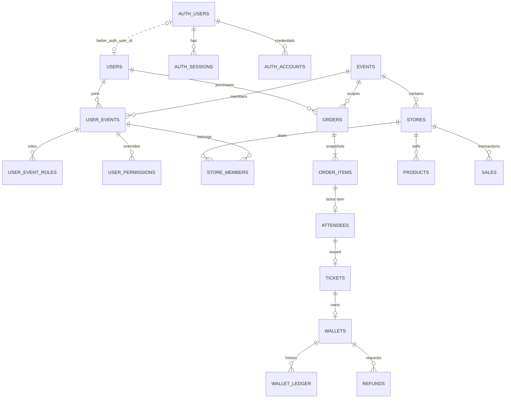

# รีวิวฐานข้อมูล TUATUA

> เอกสารประวัติของ schema ธุรกิจเดิม 35 ตาราง ปัจจุบันโฟลเดอร์ฝึกมี 6 entities และใช้ Permission ราย UserRole แล้ว ให้ดู [ER ปัจจุบัน](10-database-er-diagram.md) แทนสำหรับงาน Auth/สิทธิ์รอบนี้


ตรวจ source และ migrations ใน working tree วันที่ 2 พฤศจิกายน 2569 ไม่ได้ตรวจข้อมูล/schema ของ Supabase จริง ขอบเขตระบบคือ **งานเลี้ยงรุ่นโรงเรียน/มหาวิทยาลัย**

ภาพรวม: การแยก User–Event–Store และ transaction ธุรกิจเหมาะกับระบบหลายงาน ไม่ควรย้าย Event/Store ไปเก็บเป็น array/JSON ใน User โครงสร้างปัจจุบันมี 30 ตารางธุรกิจ และเพิ่ม Better Auth 5 ตาราง (ไม่นับ `tuatua_migrations`)

## ความสัมพันธ์หลัก



Cardinality ในแผนภาพบางจุดรวมกฎของ service: order ที่บันทึกแล้วมี item แต่ไม่ได้หมายความว่า FK บังคับให้แม่มีลูกเอง

| ส่วน | ตาราง | ความหมาย |
| --- | --- | --- |
| สมาชิก/สิทธิ์ | users, user_roles, user_events, user_event_roles, user_permissions | คนเดียวร่วมหลายงานได้ บทบาท admin/staff/vendor อยู่ใน scope งาน; superadmin เป็นระดับระบบ |
| ร้านค้า | stores, store_members, products | ร้านอยู่ในหนึ่งงาน สมาชิกหนึ่งคนอยู่ได้หลายร้าน ร้านต้อง approved จึง open ได้ |
| งาน/การขายบัตร | events, event_settings, ticket_types, shirt_variants, orders, order_items, attendees, payments | เก็บราคาขณะซื้อ แยกผู้ซื้อกับผู้เข้าร่วม และกันจำนวนระหว่างรอชำระ |
| บัตร/เข้าออก | tickets, admission_scans | ผู้ถือบัตรอาจต่างจากผู้ซื้อ สแกนมีประวัติแบบ append-only |
| Token/ร้านขาย | wallets, wallet_ledger, topups, checkout_intents, sales, sale_items, refunds | กระเป๋าต่อบัตร แยก bonus/ยอดเติม/ยอด hold; ledger เป็นประวัติ |
| สนับสนุน | user_consents, audit_logs, idempotency_records, email_outbox, rate_limit_buckets | audit/consent/retry/worker/rate limit |
| ล็อกอิน | auth_users, auth_accounts, auth_sessions, auth_verifications, auth_rate_limits | Better Auth แยกจากสิทธิ์ธุรกิจ |

## จุดที่ทำได้ดีและมีหลักฐานทดสอบ

1. `user_events` ทำ many-to-many ระหว่างคนกับงาน และ `store_members` เชื่อมสมาชิกงานที่ตรงกับร้าน ไม่เก็บ event_id ก้อนเดียวบน User
2. Composite FK `(parent_id,event_id)` กันการผูกบัตร คำสั่งซื้อ ร้าน และกระเป๋าข้ามงานที่ระดับ DB ไม่อาศัย if ฝั่ง API อย่างเดียว
3. จำนวนเงินใช้ integer หน่วยสตางค์และ Token เป็นจำนวนเต็ม ไม่คำนวณด้วย float
4. ราคาบน order_items/sale_items และเรทบนประวัติเป็น snapshot เปลี่ยนราคา catalog แล้วไม่แก้บิลเก่า
5. มี check constraint กันยอด/stock ติดลบ และ transaction/row locks/idempotency กันขายบัตรเกิน ตัดยอดซ้ำ หรือสแกนซ้ำพร้อมกัน (integration tests T11–T22)
6. `wallet_ledger`, `audit_logs`, `admission_scans`, `user_consents` มี trigger ห้าม UPDATE/DELETE; เมื่อแก้ธุรกิจต้องเพิ่มประวัติ ไม่แก้รายการเก่า
7. BaselineEnums แก้การ bootstrap ฐานว่างที่ InitialFoundation เดิมขาด enum; tests ครอบคลุมฐานเก่าและฐานใหม่
8. Auth ใหม่มี unique + FK ไป Better Auth แยกจาก UUID เดิมและ payload พร้อม RLS ไม่มี browser policy และ revoke Data API grants

## สิ่งที่ต้องจัดการต่อ

### 1. การย้ายตัวตนผู้ใช้เก่า — ต้องวางแผนก่อนเปิดใช้จริง

`User.ts` ยังมี `auth_user_id` ของ Supabase เดิม แต่ auth ใหม่ใช้ `better_auth_user_id` เท่านั้น บัญชีเก่าจะยังไม่ผูกกับล็อกอินใหม่ หากให้ signup แล้ว provision ทันทีอาจได้บัญชีธุรกิจอีกบัญชีที่ไม่มีบัตร/ประวัติเดิม

ต้องพิสูจน์เจ้าของบัญชีและทำ mapping ที่ตรวจสอบได้ก่อน cutover ไม่จับคู่จาก email อย่างเดียว ไม่เปลี่ยน users.id และไม่คัดลอก password hash โดยไม่ตรวจความเข้ากันได้ งานนี้เตรียมคอลัมน์และรักษาข้อมูลไว้แล้ว ยังไม่ย้ายตัวตนจริง

### 2. บทบาทของ DB runtime กับ RLS — ยังอาศัยเจ้าของตาราง

`AppendOnlyAndDataApiLockdown` เปิด RLS โดยไม่มี policy จึงปิด browser Data API แต่ server ทำงานได้เพราะใช้ role เจ้าของตารางซึ่ง bypass RLS ผลคือ bug หรือ credential รั่วฝั่ง server ยังเข้าถึงข้ามงาน/DDL ได้ตามสิทธิ์ของ role นั้น

ควรแยก migration role ออกจาก runtime role พร้อม grant/policy ที่เหมาะสม และทดสอบด้วย runtime role นั้นจริง การเปลี่ยนเป็น non-owner อย่างเดียวทำให้ query ปัจจุบันถูก RLS ปฏิเสธได้ ห้ามสรุปว่า RLS ปัจจุบันเป็น tenant isolation ของ server

### 3. ยังไม่มีแบบจำลองสถาบันและรุ่น — ข้อเสนอด้านผลิตภัณฑ์

`events` มีชื่อ/สถานที่/เวลา แต่ยังไม่มี institution/cohort FK ส่วน User มี graduation_year_be/faculty ได้เพียงชุดเดียว ไม่พอสำหรับคนที่จบทั้งโรงเรียนและมหาวิทยาลัย หรือมีหลายรุ่น/คณะ และชื่อสถาบันที่กรอกเองอาจสะกดต่างกันจนค้นไม่เจอ

ถ้าจะใช้ค้นงานตามโรงเรียน มหาวิทยาลัย ห้อง หรือปีรุ่น แนะนำเพิ่มภายหลัง:

```text
institutions(id, name, type)
cohorts(id, institution_id, label, entry_year_be?, graduation_year_be?, faculty?, room?)
user_educations(user_id, cohort_id, ...)
event_cohorts(event_id, cohort_id)  -- งานหนึ่งเปิดให้หลายรุ่นได้
```

นี่เป็นข้อเสนอ ยังไม่ได้เพิ่มตารางหรือเปลี่ยนข้อมูลจริง ต้องตกลงความหมายของปีเข้า/ปีจบ/รุ่นก่อน ไม่ควรยัดทุกความหมายลง graduation_year_be

### 4. สถานะธุรกิจยังเป็น scope จำลอง

`domain.enum.ts` กำหนด settlement_mode เป็น `mock` เท่านั้น, ticket_status เป็น `active` เท่านั้น และ order_status มี pending_payment/paid/expired จึงยังไม่รองรับวงจรชำระเงินจริง ยกเลิกบัตร chargeback หรือ refund ค่าบัตรครบชุด

เหมาะกับต้นแบบตาม requirement ที่ยืนยันไว้ แต่ก่อนเก็บเงินจริงต้องเพิ่ม payment provider reference/webhook signature/idempotency และ state transitions ไม่ใช้ endpoint payments/mock แทนหลักฐานชำระเงินจริง

### 5. การเก็บประวัติและงาน cleanup ยังต้องมีแผน

Ledger/audit/consent เป็น append-only และมี PII ในข้อมูลผู้ซื้อ/ผู้ร่วมงาน จึงควรตกลง retention, anonymization และวิธีตอบคำขอลบข้อมูลที่ไม่ทำลายหลักฐานบัญชีโดยตรง ขณะนี้ไม่มี endpoint ลบ auth user และ FK แบบ RESTRICT ตั้งใจรักษาประวัติ

auth_sessions/auth_verifications มี expiry index แต่ยังไม่ได้เพิ่ม scheduler ล้างรายการหมดอายุ; rate-limit/idempotency/audit จะโตตามการใช้ ต้องกำหนด retention และวัดก่อนเพิ่ม partition ไม่ควร drop ประวัติทั้งชุดเพื่อแก้ขนาด DB

### 6. Indexes/โหลดจริงยังไม่ได้ benchmark

มี index สำหรับ event/status/expiry, user/created_at, wallet/created_at และ reference uniqueness แล้ว แต่ผลทดสอบ 28 เคสไม่ใช่โหลดจริง ต้อง EXPLAIN (ANALYZE, BUFFERS) query ของรายงาน/หน้ารายการบนข้อมูลตัวอย่างที่มีขนาดเหมาะสมก่อนเลือกเพิ่ม index และพิจารณา keyset pagination เมื่อข้อมูลมาก

### 7. การเชื่อมต่อบน Cloudflare ยังไม่ยืนยัน

ตอนนี้ pool ของ TypeORM และ Better Auth แยกกัน ต้องนับ connection รวมเมื่อ scale; ผ่านบน Node.js + PostgreSQL 18 ในเครื่องแล้ว แต่ยังไม่ทดสอบ workerd/Hyperdrive หรือ SMTP ผ่าน Workers อย่าถือว่า Node build ที่ผ่านเท่ากับ deploy Cloudflare ผ่าน

### 8. Dependency audit ที่ติดมากับ dev

ตรวจ npm audit ของ package/lockfile ก่อนและหลังเพิ่ม backend แล้ว ทั้งคู่รายงาน 31 รายการ (high 7, moderate 22, low 2) และไม่มี package ในรายงานเพิ่มจากงานนี้ โดยมี dependency chain ของ Cloudflare/OpenNext/เครื่องมือเดิมรวมอยู่ด้วย ควรแยกงานอัปเดตและทดสอบ build/preview ให้ครบ ไม่ใช้ audit fix --force ซึ่งเสนอเปลี่ยน major/ย้อนเวอร์ชันบางเครื่องมือ เพื่อรักษา package ของ dev ตามขอบเขตที่ผู้ใช้ระบุ

## สิ่งที่แก้จากรีวิวในรอบนี้

- แยก Better Auth identity อย่างชัดเจน คง IDs/ข้อมูลเดิม เพิ่ม FK, unique, RLS, grant lockdown และป้องกัน revert ที่จะลบ credentials
- ทดสอบก่อนเขียนกับ DB จริง และเพิ่ม guard ให้ integration tests รับเฉพาะ localhost และชื่อ DB ลงท้าย `_test` เพื่อไม่ล้าง schema ของ DB local ที่ใช้จริงโดยเผลอ
- ส่ง pg driver ให้ TypeORM โดยตรงเพื่อไม่พึ่ง dynamic require ใน bundle และปิดการย่อชื่อ server class เพื่อแก้ TypeORM ตรวจ dependency ผิดใน Next production
- Mutation origin ของ API ใช้ canonical BETTER_AUTH_URL แทน caller-supplied forwarded host

ไม่ได้เปลี่ยนโครงสร้างธุรกิจที่ไม่เกี่ยวกับ auth ไม่รัน migration/SQL กับ Supabase จริง ดูวิธีรันและผลตรวจใน [08-better-auth.md](08-better-auth.md)
