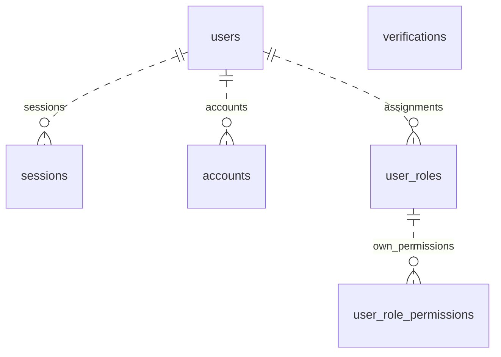
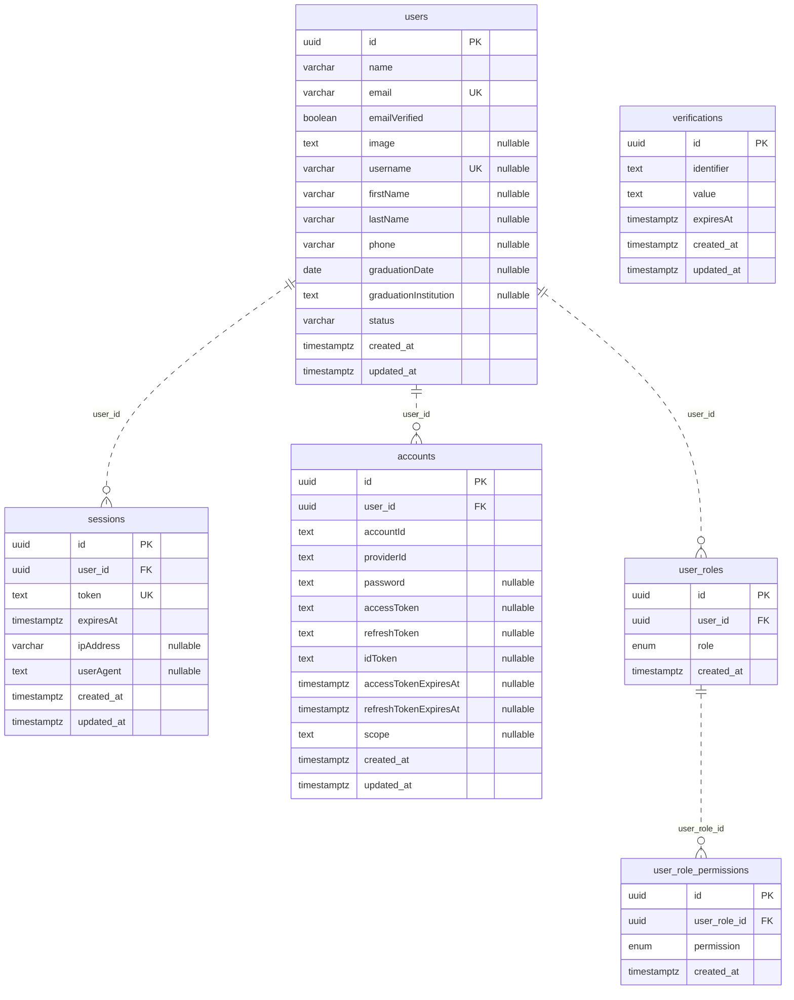

# ER Diagram — Auth และสิทธิ์รายผู้ใช้

อัปเดต 2 พฤศจิกายน 2569 จาก TypeORM metadata: **6 ตาราง / 4 Foreign Keys** ไม่รวมตารางประวัติ migration เอกสารนี้แทน ER เดิม 35 ตาราง ไม่ได้เชื่อมต่อฐานข้อมูลจริงเพื่อสร้างแผนภาพ

## ความต้องการที่ใช้

- User หนึ่งคนมีหลาย Role ได้
- User คนละคนที่มีชื่อ Role เดียวกันมี Permissions ต่างกันได้
- Permission เป็นของรายการ UserRole ของผู้ใช้คนนั้น ไม่มีชุดสิทธิ์กลางที่แจกให้ทุกคนตามชื่อ Role
- สิทธิ์ยังอยู่เป็นกลุ่มใต้แต่ละ Role ของคนนั้น ไม่สร้างรายการรวมข้ามผู้ใช้หรือแจก Permission อัตโนมัติ

## ภาพรวม



`Role` เป็น enum ที่ระบุชื่อบทบาท ไม่ใช่ตาราง roles ส่วน PERMISSIONS เป็นรายการรหัสที่อนุญาต ไม่ใช่ตัวกำหนดว่าใครมีสิทธิ์อะไร

| ตาราง | หน้าที่ |
| --- | --- |
| users | ตัวผู้ใช้และโปรไฟล์ ใช้ id เดียวกับบัญชีล็อกอินที่วางแผนไว้ |
| sessions | session ของผู้ใช้แต่ละอุปกรณ์ |
| accounts | credentials / provider ที่ผูกกับผู้ใช้ |
| verifications | verification/reset records ไม่มี FK ไป users |
| user_roles | บทบาทของ User คนนั้น มี id ของ assignment แยกต่างหาก |
| user_role_permissions | Permission ของ assignment นั้น ชี้ user_role_id |

## ทำไม Permission ไม่ต้องมี user_id ซ้ำ

เจ้าของอ่านผ่าน `user_role_permissions.user_role_id -> user_roles.id -> user_roles.user_id -> users.id` ชื่อ Role เหมือนกันไม่ได้ทำให้เป็น assignment เดียวกัน

ตัวอย่างต่อไปนี้ใช้ U1/UR1 เป็นชื่อย่อ ไม่ใช่ค่า UUID สำหรับนำไปรัน SQL:

| user_roles.id | user_id | role |
| --- | --- | --- |
| UR1 | U1 | STAFF |
| UR2 | U2 | STAFF |
| UR3 | U1 | VENDOR |

| user_role_id | permission |
| --- | --- |
| UR1 | ticket.scan |
| UR2 | report.read |
| UR3 | store.sell |

U1 มี STAFF ที่สแกนบัตรได้ และ VENDOR ที่ขายของได้ ส่วน STAFF ของ U2 อ่านรายงานได้ การเพิ่ม/ลบ Permission ของ UR1 ไม่เปลี่ยน UR2

## ความสัมพันธ์ใน TypeORM

- `User.userRoles` -> `UserRole[]`
- `UserRole.user` -> User เจ้าของ assignment
- `UserRole.permissions` -> `UserRolePermission[]` ของ assignment นี้
- `UserRolePermission.userRole` -> UserRole ที่เป็นเจ้าของ Permission

ตัวอย่างโหลดข้อมูลของ User ที่ยืนยันตัวตนแล้ว โดยคงกลุ่ม Role:

```ts
const user = await database.getRepository(User).findOne({
    where: { id: authenticatedUserId },
    relations: {
        userRoles: {
            permissions: true,
        },
    },
});
```

เมื่อเขียน API ภายหลังต้องใช้ User ID จาก session และตรวจสิทธิ์ผู้แก้ไขก่อนบันทึก grant การมี FK ไม่ได้ตรวจสิทธิ์ HTTP ให้เอง งานนี้ปรับเฉพาะ schema ไม่เพิ่ม API กลับมา

## Constraints

- `UNIQUE (user_id, role)` กัน Role ชื่อเดิมซ้ำในคนเดียว คนละ User ยังใช้ชื่อ Role เดียวกันได้
- `UNIQUE (user_role_id, permission)` กัน Permission ซ้ำใน assignment เดียว คนละ assignment ใช้รหัส Permission เดียวกันได้
- `user_role_permissions.user_role_id` เป็น FK แบบ NOT NULL ไป `user_roles.id`
- ลบ UserRole แล้ว CASCADE เฉพาะ Permission ของ assignment นั้น ไม่กระทบ UserRole หรือ Permissions ของคนอื่น
- `user_roles.user_id` คง ON DELETE RESTRICT ตาม schema เดิม

## ER ครบทุกคอลัมน์



ไฟล์สำหรับนำไปเปิดใน Mermaid editor: [database-er.mmd](database-er.mmd)

## รายละเอียดตาราง

### `users` — [User](../server/database/entities/User.ts)

| Column | Type | Key | NULL |
| --- | --- | --- | --- |
| `id` | uuid | PK | ไม่ได้ |
| `name` | varchar(255) | — | ไม่ได้ |
| `email` | varchar(255) | UK | ไม่ได้ |
| `emailVerified` | boolean | — | ไม่ได้ |
| `image` | text | — | ได้ |
| `username` | varchar(255) | UK | ได้ |
| `firstName` | varchar(255) | — | ได้ |
| `lastName` | varchar(255) | — | ได้ |
| `phone` | varchar(10) | — | ได้ |
| `graduationDate` | date | — | ได้ |
| `graduationInstitution` | text | — | ได้ |
| `status` | varchar(20) | — | ไม่ได้ |
| `created_at` | timestamptz | — | ไม่ได้ |
| `updated_at` | timestamptz | — | ไม่ได้ |


### `sessions` — [Session](../server/database/entities/Session.ts)

| Column | Type | Key | NULL |
| --- | --- | --- | --- |
| `id` | uuid | PK | ไม่ได้ |
| `user_id` | uuid | FK | ไม่ได้ |
| `token` | text | UK | ไม่ได้ |
| `expiresAt` | timestamptz | — | ไม่ได้ |
| `ipAddress` | varchar(255) | — | ได้ |
| `userAgent` | text | — | ได้ |
| `created_at` | timestamptz | — | ไม่ได้ |
| `updated_at` | timestamptz | — | ไม่ได้ |

- FK `(user_id)` -> `users(id)` ON DELETE `CASCADE`

### `accounts` — [Account](../server/database/entities/Account.ts)

| Column | Type | Key | NULL |
| --- | --- | --- | --- |
| `id` | uuid | PK | ไม่ได้ |
| `user_id` | uuid | FK | ไม่ได้ |
| `accountId` | text | — | ไม่ได้ |
| `providerId` | text | — | ไม่ได้ |
| `password` | text | — | ได้ |
| `accessToken` | text | — | ได้ |
| `refreshToken` | text | — | ได้ |
| `idToken` | text | — | ได้ |
| `accessTokenExpiresAt` | timestamptz | — | ได้ |
| `refreshTokenExpiresAt` | timestamptz | — | ได้ |
| `scope` | text | — | ได้ |
| `created_at` | timestamptz | — | ไม่ได้ |
| `updated_at` | timestamptz | — | ไม่ได้ |

- Unique ร่วม: `(providerId, accountId)`
- FK `(user_id)` -> `users(id)` ON DELETE `CASCADE`

### `verifications` — [Verification](../server/database/entities/Verification.ts)

| Column | Type | Key | NULL |
| --- | --- | --- | --- |
| `id` | uuid | PK | ไม่ได้ |
| `identifier` | text | — | ไม่ได้ |
| `value` | text | — | ไม่ได้ |
| `expiresAt` | timestamptz | — | ไม่ได้ |
| `created_at` | timestamptz | — | ไม่ได้ |
| `updated_at` | timestamptz | — | ไม่ได้ |


### `user_roles` — [UserRole](../server/database/entities/UserRole.ts)

| Column | Type | Key | NULL |
| --- | --- | --- | --- |
| `id` | uuid | PK | ไม่ได้ |
| `user_id` | uuid | FK | ไม่ได้ |
| `role` | enum: ADMIN, VENDOR, STAFF, USER | — | ไม่ได้ |
| `created_at` | timestamptz | — | ไม่ได้ |

- Unique ร่วม: `(user_id, role)`
- FK `(user_id)` -> `users(id)` ON DELETE `RESTRICT`

### `user_role_permissions` — [UserRolePermission](../server/database/entities/UserRolePermission.ts)

| Column | Type | Key | NULL |
| --- | --- | --- | --- |
| `id` | uuid | PK | ไม่ได้ |
| `user_role_id` | uuid | FK | ไม่ได้ |
| `permission` | enum: event.create, event.update, ticket.scan, token.topup, token.refund.approve, store.manage, store.sell, report.read, report.export, permission.manage | — | ไม่ได้ |
| `created_at` | timestamptz | — | ไม่ได้ |

- Unique ร่วม: `(user_role_id, permission)`
- FK `(user_role_id)` -> `user_roles(id)` ON DELETE `CASCADE`

## ทดสอบ

`npm run test:db` ตรวจ metadata และเส้นทาง join โดยไม่ต่อ DB

`npm run test:db:integration` ตรวจพฤติกรรมกับฐานทดสอบแบบทิ้งได้เท่านั้น โดย runner ไม่อ่าน .env หรือ DATABASE และรับเฉพาะ localhost:54329/tuatua_permissions_test ตารางในฐานทดสอบนี้จะถูกรีเซ็ต

ตัวอย่างเปิดฐานทดสอบด้วย Docker (เมื่อ Docker ทำงานอยู่):

```powershell
docker run -d --name tuatua-permissions-test -e POSTGRES_USER=tuatua -e POSTGRES_PASSWORD=tuatua -e POSTGRES_DB=tuatua_permissions_test -p 127.0.0.1:54329:5432 postgres:18-alpine
npm run test:db:integration
```

## สถานะ migration

ยังไม่ได้สร้างหรือรัน migration กับ DATABASE จริงในงานนี้ เพราะยังไม่ตรวจ schema ปลายทาง ปรับ entity ไม่ได้เปลี่ยนฐานข้อมูลที่เคย migrate ไปเอง

เมื่อพร้อมให้ generate migration แล้วตรวจ SQL ก่อน run หากมี role_permissions กลางหรือ Role ซ้ำในข้อมูลเก่า ต้องตัดสินใจย้าย/จัดข้อมูลให้ชัด ไม่คัดลอกสิทธิ์กลางไปให้ทุก User อัตโนมัติ และไม่ใช้ CASCADE เพื่อตัดปัญหาข้อมูลเก่า

โฟลเดอร์ตัวอย่าง YIERSANSIR-server-auth คงแบบเดิมไว้ ไม่ได้ปรับตาม schema ใหม่ในโฟลเดอร์ฝึก
